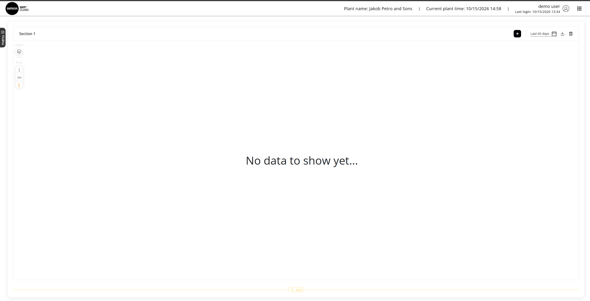
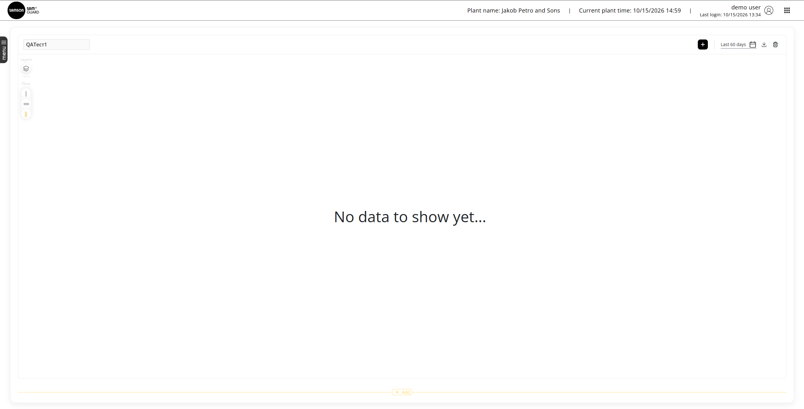
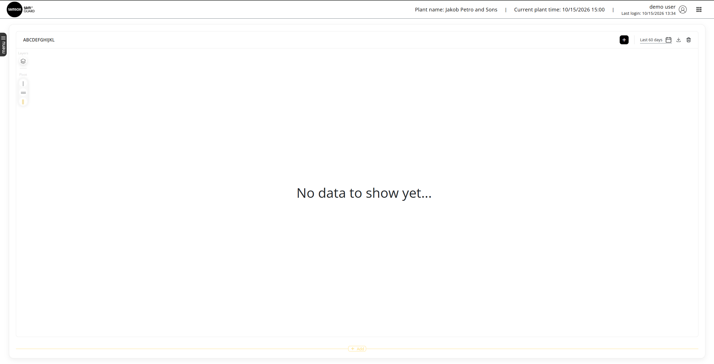

# Part C — Exploratory Testing: Bug Reports

**Application:** SAM GUARD Demo — Dashboard → Trend View  
**Environment:** https://demo-3.client.samguard.co/investigation/#/dashboard/trend  
**Verification:** All three issues were reproduced and rechecked after page refresh (F5) by the tester on 15 October 2026.

---

## BUG-001 — ADD TREND creates and persists a section without required configuration or tags

**Severity:** High

**Preconditions:** User is logged in and on Dashboard → Trend View; fewer than four sections exist.

**Steps to reproduce:**
1. Click **+ ADD TREND** in the empty state (or **+ Add** below existing sections).
2. Observe whether a configuration popup appears.
3. Do not add any tags to the newly created section.
4. Refresh the page (F5).
5. Inspect the newly created section and its assigned tags.

**Actual result:** A new section named **Section N** is immediately created without opening a configuration popup or requiring tag selection. The section remains present **with zero tags** after page refresh.

**Expected result:** Clicking **Add Section** should open a configuration popup where the user can provide a section name and select at least one tag. A section without any tag must not be accepted as a completed section.

**Additional information:**
- **Requirements:** §2.2 — section configuration popup and mandatory name/tag; §2.3 — tags can be selected during initial section creation; §2.4 — persisted changes.
- **Impact:** Invalid section configurations can be persisted; the documented setup flow is bypassed.
- **Evidence:** .

---

## BUG-002 — Inline section rename accepts and persists Cyrillic characters

**Severity:** Medium

**Preconditions:** User is logged in and on Trend View; at least one section exists.

**Steps to reproduce:**
1. Click the section title to activate inline editing.
2. Replace the title with **QAТест1** (seven characters, including Cyrillic letters).
3. Commit the edit.
4. Refresh the page (F5).
5. Check the section title.

**Actual result:** The section title **QAТест1** is accepted and remains unchanged after refresh.

**Expected result:** Section names must contain **English letters (A–Z, a–z) and digits (0–9) only**; Cyrillic characters must not be accepted as a valid user-entered section name.

**Additional information:**
- **Requirements:** §2.2 — section-name character restrictions.
- **Impact:** Invalid section names are saved, violating the naming rule.
- **Evidence:** 

---

## BUG-003 — Section title longer than 10 characters persists and is displayed without an ellipsis

**Severity:** Medium

**Preconditions:** User is logged in and on Trend View; at least one section exists.

**Steps to reproduce:**
1. Click the section title to activate inline editing.
2. Enter **ABCDEFGHIJKL** (12 English letters).
3. Commit the edit.
4. Refresh the page (F5).
5. Inspect the title displayed on the section.

**Actual result:** The full 12-character title **ABCDEFGHIJKL** is saved and remains fully visible after refresh, without truncation or an ellipsis (`…`).

**Expected result:** Under §2.2, the maximum permitted section-name length is 10 characters; the same section states that names longer than 10 characters should be displayed truncated with an ellipsis (`…`). The implementation should enforce the agreed length rule and must not display an overlength title in full.

**Additional information:**
- **Requirements:** §2.2 — maximum section-name length (10) and ellipsis for longer displayed names.
- **Impact:** Overlength names persist and display in a way that violates the specified visual rule.
- **Requirement clarification:** The specification simultaneously defines a hard 10-character maximum and display truncation for names exceeding 10. Product/R&D should clarify whether longer values may be stored; the current full, untruncated display violates the truncation statement regardless.
- **Evidence:**
